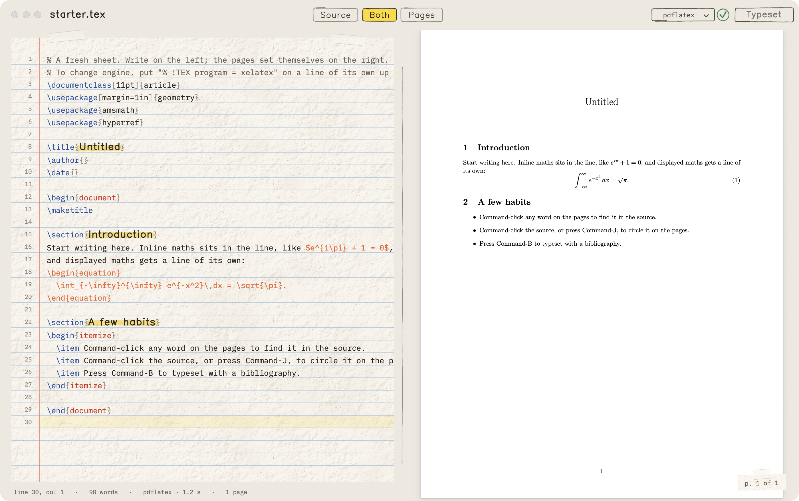
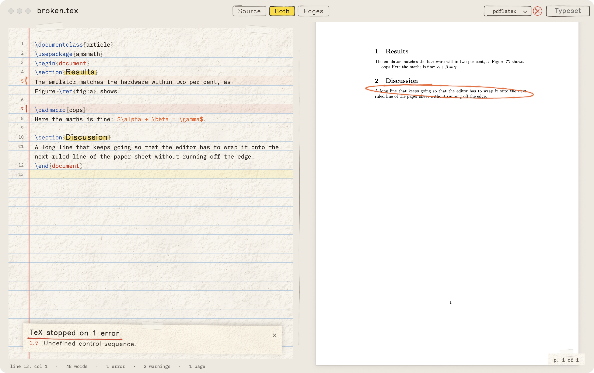

# Galley

**A TeX editor and PDF viewer for the Mac, on paper.**

Write LaTeX on the left; the typeset pages appear on the right a moment after you stop typing, the way MacDown does for Markdown. The source sits on a sheet of ruled paper taped to a stone desk, coloured in felt-pen inks, and the app talks back in hand-drawn marks: a highlighter swipe, an orange felt circle, a red squiggle in the margin.

Named after the galley proof, the first printed copy of a page that a typesetter hands back for checking.



## Features

**Live typesetting**
- Pages refresh about a second after you pause. Your file is only written when you save (⌘S); drafts are typeset in a cache, so nothing appears in your folder until you ask.
- `\input`, `\include`, figures and `.bib` files are found beside your source, as if TeX ran there.
- Engines: pdflatex, xelatex, lualatex and [Tectonic](https://tectonic-typesetting.github.io). A line such as `% !TEX program = xelatex` at the top of the file picks the engine.
- ⌘B typesets with the bibliography (BibTeX or Biber, and the extra passes they need).

**Source and pages, linked (SyncTeX)**
- ⌘-click anywhere on the pages to jump to that line of source; it is swiped with a highlighter.
- ⌘-click the source, or press ⌘J, and the spot is circled on the page in orange felt.

**When TeX complains**
- A taped slip lists the errors; click one to go to its line. Errors inside an `\input` chapter point at that chapter's file.
- Lines with errors get a red felt mark in the margin; warnings get an orange one.
- A missing package says how to get it.



**Also**
- Opens `.bib`, `.sty` and `.cls` files for editing, and plain PDFs in a reader window.
- Export PDF (⌘E), Print (⌘P), find and replace, ⌘/ to comment lines, three layouts (⌘1 source, ⌘2 both, ⌘3 pages).
- Light paper by default; View › Follow System Dark Mode for night paper. View › Animations turns the motion off (so does macOS's Reduce Motion).

## Install

You need macOS 14 or later and a TeX installation:

```sh
brew install --cask mactex-no-gui    # full TeX Live, or
brew install tectonic                # small, fetches packages as needed
```

### Download

Get `Galley-<version>.dmg` from the [latest release](../../releases/latest), open it and drag Galley to Applications.

Galley is not signed with a paid Apple developer certificate, so macOS blocks it the first time. Open it once, then go to **System Settings › Privacy & Security** and click **Open Anyway**. Or, in Terminal:

```sh
xattr -dr com.apple.quarantine /Applications/Galley.app
```

### From source

Needs Xcode or the Command Line Tools (`xcode-select --install`).

```sh
git clone https://github.com/prnil/galley.git
cd galley
scripts/install.sh
```

This builds Galley, installs it to `/Applications` (or `~/Applications`) and opens it. Built on your own Mac, it opens without the warning above.

## Keys

| Key | Does |
| --- | --- |
| ⌘R | Typeset now |
| ⌘B | Typeset with bibliography |
| ⌘J or ⌘-click source | Show the line on the pages |
| ⌘-click pages | Show the spot in the source |
| ⌘' | Next error |
| ⌘⇧L | Show what TeX said |
| ⌘E | Export PDF |
| ⌘/ | Comment or uncomment lines |
| ⌘1, ⌘2, ⌘3 | Source, both, pages |
| ⌘= ⌘- ⌘0 | Zoom pages, fit width |
| ⌥⌘= ⌥⌘- | Bigger or smaller source text |

## Building

```sh
./make_app.sh                       # build/Galley.app
./make_app.sh --install             # and copy it to /Applications
build/Galley.app/Contents/MacOS/Galley --selftest   # typesets real documents and checks the results
scripts/package.sh                  # universal .dmg and .zip in dist/
```

The app is native Swift (AppKit and PDFKit) with no dependencies.

## Credits

The paper look comes from [Looseleaf](https://kevintngo.github.io/looseleaf/) (MIT): its colours, paper textures, the Kevin Sans typeface, and its felt-pen engine, ported to Swift. Page numbers use IBM Plex Mono (SIL Open Font License). Licences are in `Resources/Fonts`.

## Licence

MIT. See [LICENSE](LICENSE).
